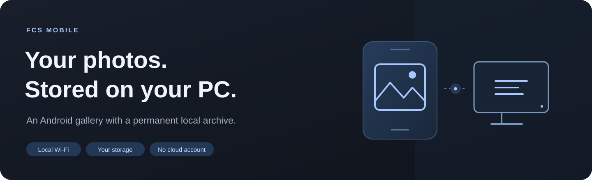
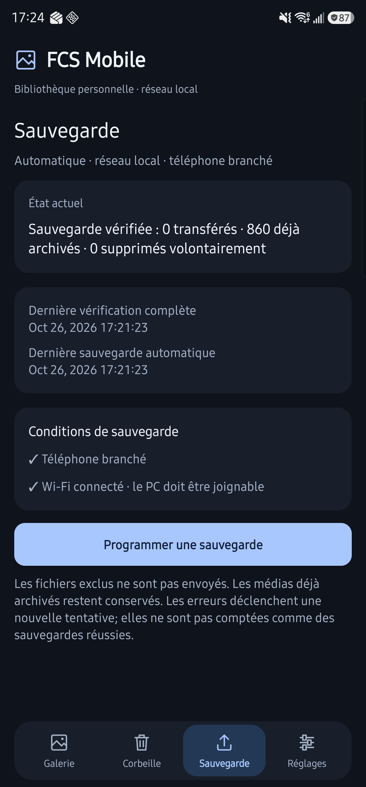
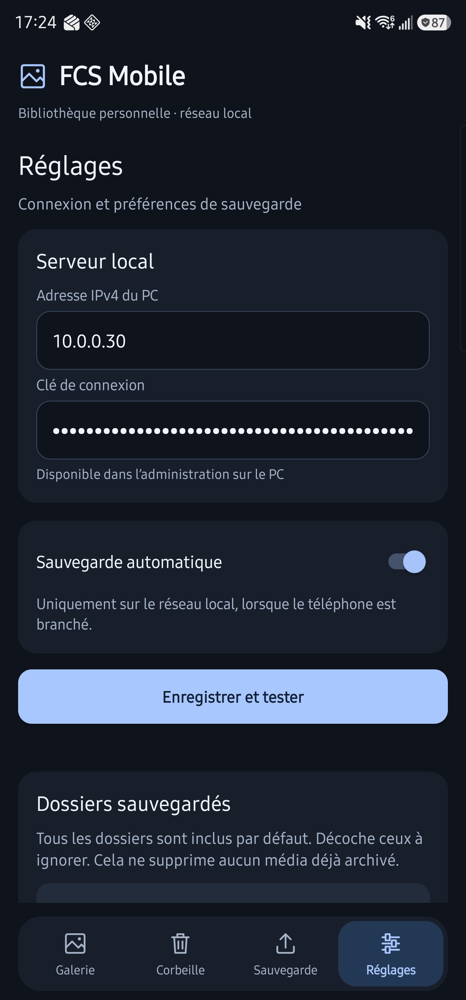

# FCS Mobile

**Say goodbye to costly cloud subscriptions. Keep your photos and your privacy in your own hands.**

A self-hosted photo and video gallery for Android, backed by your own Windows PC.

Keep your photos and videos in a permanent local archive, then browse them from your phone over Wi-Fi. Removing a file from your phone leaves its archived copy intact. Your PC provides the storage; the Android app provides the gallery.

**Android 12+ · Windows · Local Wi-Fi · Self-hosted**

[Features](#features) · [Screenshots](#screenshots) · [Installation](SETUP_GUIDE.md) · [Storage](#storage-and-retention) · [Documentation](#documentation)

## Features

| Feature | What it does |
| --- | --- |
| **Independent archive** | Keeps received photos and videos even after they are removed from the phone. |
| **Automatic backups** | Schedules transfers while the phone is plugged in and the PC is reachable over local Wi-Fi. |
| **Folder exclusions** | Includes accessible photo and video folders by default, with exclusions configurable from the phone. |
| **Chronological gallery** | Loads more items as you scroll, with a month/year indicator that switches to the year during fast scrolling. |
| **Media viewer** | Browse adjacent photos and videos with horizontal swipes. |
| **Visible progress** | Shows backup activity in the app and in a silent Android notification. |
| **Verified transfers** | Checks file size and SHA-256 before accepting an archive; identical content is deduplicated. |
| **Recoverable deletion** | Moves manually deleted archives to a 30-day trash, with restoration available before expiry. |

Pull down at the top of the gallery or trash to refresh. The app never deletes files from your phone and does not provide a phone-cleanup function.

## Screenshots

Browse your library and manage backups through a focused graphite and blue interface.

| Backup status | Connection and preferences |
| :---: | :---: |
|  |  |

[Open backup screenshot](docs/assets/backup-screen.png) · [Open settings screenshot](docs/assets/settings-screen.png)

## How it works

1. **Connect locally.** The phone connects directly to the PC’s private IPv4 address over Wi-Fi, using a connection key.
2. **Archive eligible media.** Android scans accessible photos and videos, applies folder exclusions, and transfers content that has not already been archived or deliberately deleted.
3. **Browse from the phone.** The PC serves thumbnails, photo previews, and video streams to the Android gallery. Removing the phone’s original does not remove the archive.

Automatic and manual backups require local Wi-Fi and a phone connected to power. Android controls the exact schedule; the PC must be running to receive files and serve the gallery. FCS Mobile is currently designed for **a single phone and a local Windows server**.

## Installation

You will need a Windows PC with Python **3.11+**, an Android **12+** phone, and a shared local network.

Follow the **[Installation guide](SETUP_GUIDE.md)** from a fresh GitHub download through server setup, Android APK compilation, and phone connection. The repository contains source code; environments, configuration, and generated APKs are created locally. The guide lists the current storage and build requirements.

## Storage and retention

Your PC stores the media library, including the original files, catalog, and previews. Keep the complete library folder when moving it or creating an additional backup.

Deleted archives remain recoverable from the trash for **30 days** before automatic cleanup. Deliberately deleted content is not automatically uploaded again from the phone.

Importing an existing photo folder and relocating a library are covered in the [maintenance instructions](SETUP_GUIDE.md#import-or-relocate-a-library).

## Network and privacy

The app connects directly over Wi-Fi to a private IPv4 address. It does not fall back to mobile data, and the library is unavailable away from the local network. Gallery images are cached only in memory on the phone; no persistent offline media cache is created.

The API uses a bearer key and restricts source networks. Administration is limited to the PC itself. Traffic uses **HTTP on the trusted local network**; remote access and HTTPS are outside the current scope. No cloud account is required.

## Documentation

The Android client uses Kotlin, AppCompat, WorkManager, OkHttp, and Media3. The Windows service uses Python, Flask, Waitress, SQLite, Pillow, and FFmpeg for video previews.

| Document | Purpose |
| --- | --- |
| [Installation guide](SETUP_GUIDE.md) | Requirements, server and phone setup, optional builds, and maintenance |
| [Documentation index](docs/README.md) | All user and developer documentation |
| [Quick reference](QUICK_REFERENCE.txt) | Service commands and daily controls |
| [Architecture](architecture.md) | Current components, API, data handling, and background work |
| [Contributing](CONTRIBUTING.md) | Development setup, tests, and publishing practices |
| [Changelog](changelog.md) | Version history and validation notes |

## License

FCS Mobile is licensed under the [MIT License](LICENSE).

---

The software interface is in **French**.

**Conçu par Sébastien Bédard**
